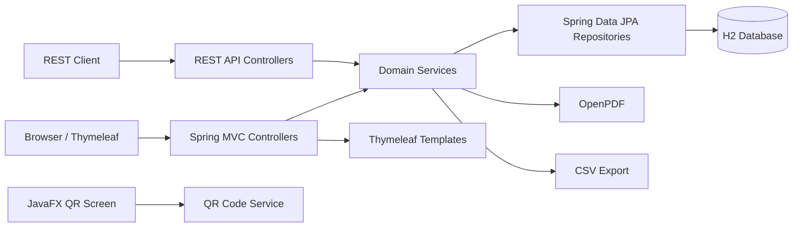
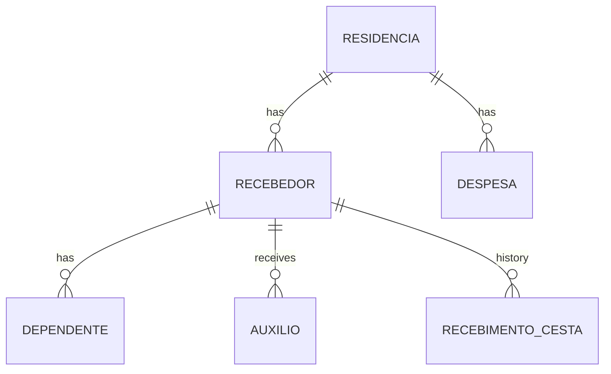

<div align="center">

<h1>Donation Control System</h1>

<p><strong>Donation management for social assistance programs</strong></p>

<p>
  <a href="README.md">English</a> | <a href="README.pt-BR.md">Português</a>
</p>

<p>
  
  
  
  
  
  
</p>

<p>
  <a href="https://github.com/VonLanplace/Donation-Controll-System">github.com/VonLanplace/Donation-Controll-System</a>
</p>

</div>

---

## Table of Contents

- [About the project](#about-the-project)
- [Current status](#current-status)
- [Features](#features)
- [Tech stack](#tech-stack)
- [Architecture](#architecture)
- [Domain model](#domain-model)
- [Business rules](#business-rules)
- [Running the application](#running-the-application)
- [Configuration](#configuration)
- [Web routes](#web-routes)
- [REST API](#rest-api)
- [API examples](#api-examples)
- [Error responses](#error-responses)
- [Tests and quality](#tests-and-quality)
- [Project structure](#project-structure)
- [Known limitations](#known-limitations)
- [Contributing](#contributing)

---

## About the project

**Donation Control System** is a Spring Boot application for managing donations and the
families supported by a social assistance program.

The current web module is focused on the complete recipient workflow:

- recipient registration;
- household/residence data;
- dependents;
- monthly income from assistance programs;
- monthly household expenses;
- monthly basket eligibility and history;
- basket receipt PDF;
- basket history CSV export.

The application also exposes a REST API for the same domain and a small JavaFX desktop
screen that displays a QR code pointing to the mobile-friendly web registration form.

The project is built with a layered architecture, uses an in-memory H2 database for
development and tests, and ships with unit, integration, and web tests.

> [!NOTE]
> The web application is functional. The JavaFX screens for donations and products are
> still UI scaffolding; the JavaFX QR code screen is functional and points to the web
> recipient form.

---

## Current status

| Area | Status |
|---|---|
| Recipient web form | Implemented |
| Recipient detail and editing | Implemented |
| Household, dependents, assistance and expenses | Implemented |
| Basket eligibility and monthly history | Implemented |
| Basket receipt PDF | Implemented |
| Basket history CSV export | Implemented |
| REST API for the domain | Implemented |
| JavaFX QR code for recipient registration | Implemented |
| JavaFX donation/product screens | UI scaffolding only |
| Authentication and authorization | Not implemented |

---

## Features

### Web application

- Single, tabbed recipient registration form:
  - personal data;
  - residence data;
  - dependents;
  - expenses and assistance;
  - interview notes and basket status.
- Search by CPF or RG.
- Search by full name.
- Paginated recipient listing with current-month basket status.
- Recipient detail with:
  - personal and interview data;
  - household address;
  - dependents;
  - expenses and assistance totals;
  - basket history;
  - eligibility for the current month.
- CSV export for a selected month range.
- PDF receipt for a received basket.

### REST API

- CRUD for recipients, residences, dependents, assistance, and expenses.
- Sum endpoints for assistance and expenses.
- Basket eligibility by document or recipient id.
- Basket history by recipient.
- Monthly basket registration/update.
- RFC 9457 problem responses for domain errors.
- OpenAPI/Swagger UI.

### JavaFX

- Desktop window that generates a QR code for the web recipient registration form.
- Automatic local IPv4 detection, or explicit base URL configuration.
- Button to open the registration URL in the default browser.

---

## Tech stack

| Layer | Technology |
|---|---|
| Language | Java 17 |
| Framework | Spring Boot 4.0.6 |
| Web | Spring MVC, Thymeleaf |
| Persistence | Spring Data JPA, Hibernate |
| Database | H2 (in-memory) |
| Mapping | MapStruct 1.6.3 |
| Boilerplate | Lombok |
| PDF | OpenPDF 1.3.39 |
| QR code | ZXing 3.5.3 |
| API docs | SpringDoc OpenAPI 3.1.1 |
| Build | Gradle 9.8.2 (wrapper) |
| Tests | JUnit 5, AssertJ, MockMvc |
| Coverage | JaCoCo 0.8.13 |
| Desktop | JavaFX 17 |

---

## Architecture



The code is organized by feature:

- `controller` and `*ViewController` handle HTTP input/output;
- `service` classes hold business rules and transaction boundaries;
- `repository` interfaces handle persistence;
- `mapper` interfaces convert between entities and DTOs;
- `form` classes represent the unified web form;
- `web` contains view helpers, pagination, options, and exception handling.

The application injects a `Clock` bean instead of calling `LocalDate.now()` directly.
This keeps month/date behavior deterministic in tests while preserving system time in
production.

---

## Domain model



| Entity | Purpose |
|---|---|
| `Recebedor` | Person supported by the program. CPF and PIX are unique when present. |
| `Residencia` | Household address shared by one or more recipients. |
| `Dependente` | Dependent linked to a recipient. |
| `Auxilio` | Monthly assistance income linked to a recipient. |
| `Despesa` | Monthly household expense linked to a residence. |
| `RecebimentoCesta` | Monthly basket record, unique per recipient and month. |
| `SnapshotRecebedor` | Embedded copy of recipient data at basket registration time. |

The basket receipt and CSV export use the snapshot, not the current recipient data.

---

## Business rules

- CPF and PIX are unique across recipients.
- PIX is ignored by the duplicate guard when blank.
- A recipient can receive at most **4 consecutive monthly baskets**.
- A `RECUSOU` (declined) record breaks the sequence and resets the counter.
- Registering the same month again updates the existing record instead of creating a
  duplicate.
- A basket month cannot be in the future.
- A PDF receipt is only available for a `RECEBEU` (received) basket.
- CSV export is limited to **60 months**.
- The unified form synchronizes child lists:
  - rows with an id are updated;
  - rows without an id are created;
  - missing rows are deleted;
  - records must belong to the current recipient or residence.
- REST searches use exact equality, not partial matching.
- The maximum page size is **100**.

---

## Running the application

### Requirements

- JDK 17
- No external database required

The Gradle wrapper is included.

### Start the application

```bash
./gradlew bootRun
```

Open:

- Web application: `http://localhost:8080`
- Recipient listing: `http://localhost:8080/recebedor`
- H2 console: `http://localhost:8080/h2-console`
- Swagger UI: `http://localhost:8080/swagger-ui/index.html`
- OpenAPI JSON: `http://localhost:8080/v3/api-docs`

### Run as web server only

JavaFX opens automatically when a display is available. To disable it:

```bash
./gradlew bootRun --args='--app.javafx.auto-iniciar=false'
```

### Build and test

```bash
./gradlew clean build
```

### H2 connection

| Property | Value |
|---|---|
| JDBC URL | `jdbc:h2:mem:db_doacao` |
| User | `sa` |
| Password | *(empty)* |

The database is in-memory, so data is lost when the process stops.

---

## Configuration

Main properties in `src/main/resources/application.properties`:

| Property | Default | Purpose |
|---|---|---|
| `spring.application.name` | `Doacao` | Application name |
| `spring.datasource.url` | `jdbc:h2:mem:db_doacao` | H2 in-memory JDBC URL |
| `spring.h2.console.enabled` | `true` | Enables the H2 web console |
| `spring.h2.console.path` | `/h2-console` | H2 console path |
| `spring.data.web.pageable.max-page-size` | `100` | Maximum page size |
| `app.javafx.auto-iniciar` | `true` | Opens the JavaFX window after startup |
| `app.web.base-url` | *(empty)* | Base URL used in the QR code; empty enables auto-detection |
| `spring.jackson.deserialization.fail-on-null-for-primitives` | `false` | Allows missing primitive fields in JSON bodies |

For QR code use on a phone, set `app.web.base-url` when the machine has multiple network
interfaces, VPN, Docker, or the phone is on another network:

```properties
app.web.base-url=http://192.168.0.10:8080
```

---

## Web routes

| Method | Path | Description |
|---|---|---|
| `GET` | `/` | Redirects to `/recebedor` |
| `GET` | `/recebedor` | Recipient listing |
| `GET` | `/recebedor/listar` | Recipient listing with `busca`, `page`, `size`, `sort` |
| `GET` | `/recebedor/consultar` | Search by CPF or RG (`documento`) |
| `GET` | `/recebedor/detalhe/{id}` | Recipient detail |
| `GET` | `/recebedor/create` | New recipient form |
| `POST` | `/recebedor/create` | Creates recipient and children |
| `GET` | `/recebedor/editar/{id}` | Edit recipient form |
| `POST` | `/recebedor/editar/{id}` | Updates recipient and synchronizes children |
| `POST` | `/recebedor/apagar/{id}` | Deletes a recipient |
| `GET` | `/recebedor/exportar.csv` | CSV export (`inicio`, `fim` as `YYYY-MM`) |
| `GET` | `/recebedor/cesta/pdf/{id}` | Basket receipt PDF |

---

## REST API

Base path: `/api`.

### Recipients

| Method | Path | Description |
|---|---|---|
| `GET` | `/api/recebedor` | Paginated listing |
| `GET` | `/api/recebedor/search` | Search by `nomeCompleto`, `dataNascimento`, `residenciaId`, `cpf`, or `pix` |
| `POST` | `/api/recebedor` | Creates a recipient |
| `GET` | `/api/recebedor/{id}` | Finds a recipient by id |
| `PUT` | `/api/recebedor/{id}` | Updates a recipient |
| `DELETE` | `/api/recebedor/{id}` | Deletes a recipient |

### Residences

| Method | Path | Description |
|---|---|---|
| `GET` | `/api/residencia` | Paginated listing |
| `GET` | `/api/residencia/search` | Search by `logradouro`, `cep`, `cidade`, or `bairro` |
| `POST` | `/api/residencia` | Creates a residence |
| `GET` | `/api/residencia/{id}` | Finds a residence by id |
| `PUT` | `/api/residencia/{id}` | Updates a residence |
| `DELETE` | `/api/residencia/{id}` | Deletes a residence |

### Dependents

| Method | Path | Description |
|---|---|---|
| `GET` | `/api/dependente` | Paginated listing; optional `recebedorId` |
| `POST` | `/api/dependente` | Creates a dependent |
| `GET` | `/api/dependente/{id}` | Finds a dependent by id |
| `PUT` | `/api/dependente/{id}` | Updates a dependent |
| `DELETE` | `/api/dependente/{id}` | Deletes a dependent |

### Assistance

| Method | Path | Description |
|---|---|---|
| `GET` | `/api/auxilio` | Paginated listing; optional `recebedorId` |
| `GET` | `/api/auxilio/soma/{recebedorId}` | Sums assistance for a recipient |
| `POST` | `/api/auxilio` | Creates an assistance record |
| `GET` | `/api/auxilio/{id}` | Finds an assistance record by id |
| `PUT` | `/api/auxilio/{id}` | Updates an assistance record |
| `DELETE` | `/api/auxilio/{id}` | Deletes an assistance record |

### Expenses

| Method | Path | Description |
|---|---|---|
| `GET` | `/api/despesa` | Paginated listing; optional `residenciaId` |
| `GET` | `/api/despesa/soma/{residenciaId}` | Sums expenses for a residence |
| `POST` | `/api/despesa` | Creates an expense |
| `GET` | `/api/despesa/{id}` | Finds an expense by id |
| `PUT` | `/api/despesa/{id}` | Updates an expense |
| `DELETE` | `/api/despesa/{id}` | Deletes an expense |

### Basket history

| Method | Path | Description |
|---|---|---|
| `GET` | `/api/recebimento-cesta/elegibilidade` | Eligibility by `documento`, optional `ano` and `mes` |
| `GET` | `/api/recebimento-cesta/elegibilidade/{recebedorId}` | Eligibility by recipient id |
| `GET` | `/api/recebimento-cesta/historico/{recebedorId}` | Basket history |
| `POST` | `/api/recebimento-cesta/{recebedorId}` | Registers or updates a monthly basket |

### Common status codes

| Code | Meaning |
|---|---|
| `200` | Successful read/update |
| `201` | Resource created |
| `204` | Resource deleted |
| `400` | Invalid request or invalid argument |
| `404` | Resource not found |
| `409` | Business conflict or data integrity violation |

---

## API examples

### Create a recipient

```bash
curl -X POST http://localhost:8080/api/recebedor \
  -H 'Content-Type: application/json' \
  -d '{
    "nomeCompleto": "Ana Souza",
    "cpf": "11122233344",
    "rgNum": "123456",
    "rgEmissor": "SSP",
    "dataNascimento": "1990-03-10",
    "telefonePessoal": "81999999999",
    "leEscreve": true,
    "email": "ana@example.org",
    "pix": "ana@example.org",
    "necessitaJuridico": false,
    "necessitaPsicologo": false,
    "parecerEntrevistador": true,
    "comentarios": "First interview.",
    "residenciaId": "00000000-0000-0000-0000-000000000000"
  }'
```

### Check basket eligibility by document

```bash
curl 'http://localhost:8080/api/recebimento-cesta/elegibilidade?documento=11122233344&ano=2026&mes=1'
```

### Register a monthly basket

```bash
curl -X POST http://localhost:8080/api/recebimento-cesta/00000000-0000-0000-0000-000000000000 \
  -H 'Content-Type: application/json' \
  -d '{
    "ano": 2026,
    "mes": "JANEIRO",
    "status": "RECEBEU",
    "observacao": "Delivered at the community center."
  }'
```

---

## Error responses

Domain errors use `application/problem+json`:

```json
{
  "type": "about:blank",
  "title": "Recurso Não Encontrado",
  "status": 404,
  "detail": "Recebedor not found: 00000000-0000-0000-0000-000000000000",
  "timestamp": "2026-01-15T15:00:00Z"
}
```

| Exception | HTTP status | Title |
|---|---|---|
| `EntityNotFoundException` | `404` | `Recurso Não Encontrado` |
| `IllegalArgumentException` | `400` | `Requisição Inválida` |
| `IllegalStateException` | `409` | `Conflito de Estado` |
| `DataIntegrityViolationException` | `409` | `Conflito de Dados` |

Web pages use a dedicated HTML error handler, so browser requests receive the
`erro/404` page instead of JSON.

---

## Tests and quality

Run the full suite:

```bash
./gradlew test
```

Current snapshot:

| Metric | Value |
|---|---|
| Tests | 246 |
| Failures | 0 |
| Line coverage | 81.5% |
| Branch coverage | 72.2% |
| Class coverage | 100% |

Reports:

- HTML test report: `build/reports/tests/test/index.html`
- JaCoCo HTML report: `build/reports/jacoco/test/html/index.html`
- JaCoCo XML report: `build/reports/jacoco/test/jacocoTestReport.xml`

Test tags:

| Tag | Purpose |
|---|---|
| `unit` | Pure unit tests |
| `integration` | Spring context + H2 integration tests |
| `web` | MockMvc web/API tests |

The test support package provides:

- reusable fixtures;
- unique CPF/PIX/RG generators;
- a fixed `Clock` at `2026-01-15T15:00:00Z` (`America/Sao_Paulo`);
- AssertJ assertions for `ProblemDetail`;
- `@IntegracaoTest` and `@WebIntegracaoTest` meta-annotations.

---

## Project structure

```text
.
├── build.gradle
├── settings.gradle
├── gradlew
├── gradlew.bat
├── src
│   ├── main
│   │   ├── java/com/vonlanplace/doacao
│   │   │   ├── DoacaoApplication.java
│   │   │   ├── exception
│   │   │   ├── javafx
│   │   │   │   ├── controller
│   │   │   │   ├── qrcode
│   │   │   │   └── springIntegration
│   │   │   ├── recebedor
│   │   │   │   ├── auxilio
│   │   │   │   ├── cesta
│   │   │   │   ├── controller
│   │   │   │   ├── dependente
│   │   │   │   ├── form
│   │   │   │   └── residencia
│   │   │   └── web
│   │   └── resources
│   │       ├── application.properties
│   │       ├── static
│   │       └── templates
│   └── test
│       └── java/com/vonlanplace/doacao
│           ├── exception
│           ├── javafx
│           ├── recebedor
│           ├── support
│           └── web
├── README.md
└── README.pt-BR.md
```

---

## Known limitations

- There is no authentication or authorization in the current codebase.
- H2 is in-memory; all data is lost when the application stops.
- The JavaFX donation and product screens are still UI scaffolding.
- REST search filters use exact equality and do not normalize case or accents.
- There is no database migration tool configured.
- The application is designed for a single local deployment, not a clustered setup.

---

## Contributing

1. Create a branch from `dev`.
2. Keep commits focused and use conventional commit messages.
3. Run the test suite before opening a pull request:

```bash
./gradlew test
```

4. Describe the behavior change, not only the files changed.

---

<div align="center">

<a href="README.pt-BR.md">Leia em português</a>

</div>
