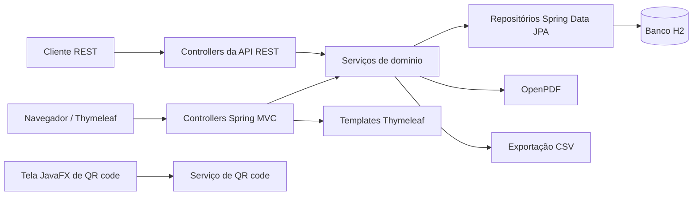
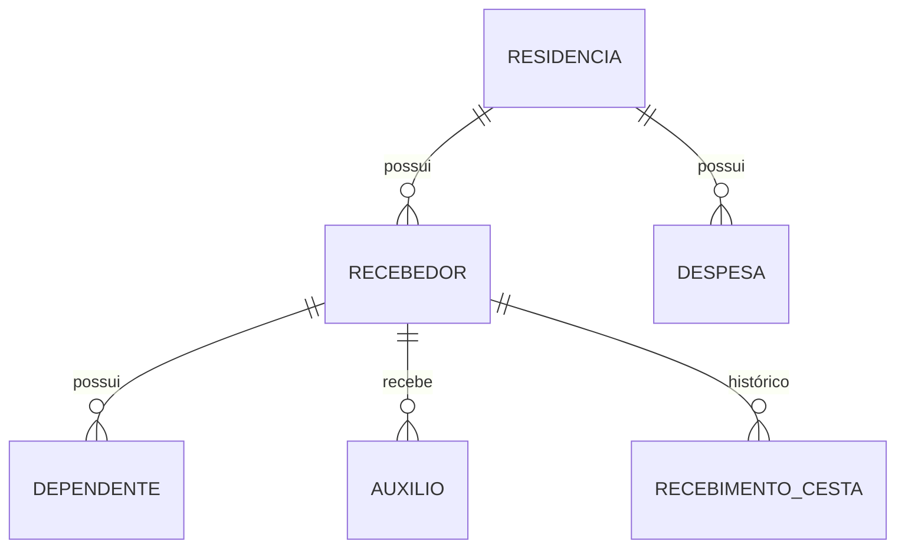

<div align="center">

<h1>Sistema de Doação</h1>

<p><strong>Controle de doações para programas de assistência social</strong></p>

<p>
  <a href="README.md">English</a> | <a href="README.pt-BR.md">Português</a>
</p>

<p>
  
  
  
  
  
  
</p>

<p>
  <a href="https://github.com/VonLanplace/Donation-Controll-System">github.com/VonLanplace/Donation-Controll-System</a>
</p>

</div>

---

## Índice

- [Sobre o projeto](#sobre-o-projeto)
- [Estado atual](#estado-atual)
- [Funcionalidades](#funcionalidades)
- [Stack técnica](#stack-técnica)
- [Arquitetura](#arquitetura)
- [Modelo de domínio](#modelo-de-domínio)
- [Regras de negócio](#regras-de-negócio)
- [Como executar](#como-executar)
- [Configuração](#configuração)
- [Rotas web](#rotas-web)
- [API REST](#api-rest)
- [Exemplos de API](#exemplos-de-api)
- [Respostas de erro](#respostas-de-erro)
- [Testes e qualidade](#testes-e-qualidade)
- [Estrutura do projeto](#estrutura-do-projeto)
- [Limitações conhecidas](#limitações-conhecidas)
- [Contribuição](#contribuição)

---

## Sobre o projeto

O **Sistema de Doação** é uma aplicação Spring Boot para gerenciar doações e as famílias
atendidas por um programa de assistência social.

O módulo web atual cobre o fluxo completo do recebedor:

- cadastro do recebedor;
- dados da residência;
- dependentes;
- renda mensal de auxílios;
- despesas mensais da residência;
- elegibilidade e histórico mensal de cestas;
- recibo da cesta em PDF;
- exportação do histórico de cestas em CSV.

A aplicação também expõe uma API REST para o mesmo domínio e uma pequena tela JavaFX que
mostra um QR code apontando para o formulário web de cadastro, adequado para uso no
celular.

O projeto usa arquitetura em camadas, banco H2 em memória para desenvolvimento e testes,
e possui testes unitários, de integração e de camada web.

> [!NOTE]
> A aplicação web está funcional. As telas JavaFX de doação e produto ainda são esqueleto
> de interface; a tela JavaFX de QR code está funcional e aponta para o formulário web de
> recebedor.

---

## Estado atual

| Área | Status |
|---|---|
| Formulário web de recebedor | Implementado |
| Detalhe e edição de recebedor | Implementado |
| Residência, dependentes, auxílios e despesas | Implementado |
| Elegibilidade e histórico mensal de cestas | Implementado |
| Recibo da cesta em PDF | Implementado |
| Exportação do histórico em CSV | Implementado |
| API REST do domínio | Implementado |
| QR code JavaFX para cadastro de recebedor | Implementado |
| Telas JavaFX de doação/produto | Apenas esqueleto de interface |
| Autenticação e autorização | Não implementado |

---

## Funcionalidades

### Aplicação web

- Formulário único de recebedor com abas:
  - dados pessoais;
  - dados da residência;
  - dependentes;
  - despesas e auxílios;
  - observações da entrevista e status da cesta.
- Consulta por CPF ou RG.
- Busca por nome completo.
- Listagem paginada com status da cesta do mês corrente.
- Detalhe do recebedor com:
  - dados pessoais e da entrevista;
  - endereço da residência;
  - dependentes;
  - totais de despesas e auxílios;
  - histórico de cestas;
  - elegibilidade para o mês corrente.
- Exportação CSV por intervalo de meses.
- Recibo em PDF para cesta recebida.

### API REST

- CRUD de recebedores, residências, dependentes, auxílios e despesas.
- Endpoints de soma para auxílios e despesas.
- Elegibilidade de cesta por documento ou id do recebedor.
- Histórico de cestas por recebedor.
- Registro/atualização mensal da cesta.
- Respostas de erro no padrão RFC 9457.
- OpenAPI/Swagger UI.

### JavaFX

- Janela desktop que gera um QR code para o formulário web de cadastro de recebedor.
- Detecção automática de IPv4 local ou URL base configurada explicitamente.
- Botão para abrir a URL de cadastro no navegador padrão.

---

## Stack técnica

| Camada | Tecnologia |
|---|---|
| Linguagem | Java 17 |
| Framework | Spring Boot 4.0.6 |
| Web | Spring MVC, Thymeleaf |
| Persistência | Spring Data JPA, Hibernate |
| Banco | H2 (em memória) |
| Mapeamento | MapStruct 1.6.3 |
| Boilerplate | Lombok |
| PDF | OpenPDF 1.3.39 |
| QR code | ZXing 3.5.3 |
| Documentação da API | SpringDoc OpenAPI 3.1.1 |
| Build | Gradle 9.8.2 (wrapper) |
| Testes | JUnit 5, AssertJ, MockMvc |
| Cobertura | JaCoCo 0.8.13 |
| Desktop | JavaFX 17 |

---

## Arquitetura



O código é organizado por funcionalidade:

- `controller` e `*ViewController` tratam entrada/saída HTTP;
- classes `service` concentram regras de negócio e limites transacionais;
- interfaces `repository` cuidam da persistência;
- interfaces `mapper` convertem entre entidades e DTOs;
- classes `form` representam o formulário web unificado;
- o pacote `web` contém helpers de view, paginação, opções e tratamento de exceção.

A aplicação injeta um bean `Clock` em vez de chamar `LocalDate.now()` diretamente. Isso
mantém o comportamento de mês/data determinístico nos testes e preserva o relógio do
sistema em produção.

---

## Modelo de domínio



| Entidade | Papel |
|---|---|
| `Recebedor` | Pessoa atendida pelo programa. CPF e PIX são únicos quando informados. |
| `Residencia` | Endereço da família, compartilhado por um ou mais recebedores. |
| `Dependente` | Dependente vinculado a um recebedor. |
| `Auxilio` | Renda mensal de auxílio vinculada a um recebedor. |
| `Despesa` | Despesa mensal vinculada a uma residência. |
| `RecebimentoCesta` | Registro mensal de cesta, único por recebedor e mês. |
| `SnapshotRecebedor` | Cópia dos dados do recebedor no momento do registro da cesta. |

O recibo em PDF e a exportação CSV usam o snapshot, não os dados atuais do recebedor.

---

## Regras de negócio

- CPF e PIX são únicos entre recebedores.
- PIX em branco é ignorado pela verificação de duplicidade.
- O recebedor pode receber no máximo **4 cestas mensais consecutivas**.
- Um registro `RECUSOU` quebra a sequência e reinicia o contador.
- Registrar novamente o mesmo mês atualiza o registro existente em vez de criar outro.
- O mês da cesta não pode ser futuro.
- O recibo em PDF só existe para cesta com status `RECEBEU`.
- A exportação CSV é limitada a **60 meses**.
- O formulário unificado sincroniza as listas filhas:
  - linhas com id são atualizadas;
  - linhas sem id são criadas;
  - linhas ausentes são apagadas;
  - os registros precisam pertencer ao recebedor ou à residência atual.
- As buscas da API REST usam igualdade exata, não busca parcial.
- O tamanho máximo de página é **100**.

---

## Como executar

### Requisitos

- JDK 17
- Nenhum banco externo é necessário

O Gradle Wrapper está incluído no projeto.

### Iniciar a aplicação

```bash
./gradlew bootRun
```

Abra:

- Aplicação web: `http://localhost:8080`
- Listagem de recebedores: `http://localhost:8080/recebedor`
- Console do H2: `http://localhost:8080/h2-console`
- Swagger UI: `http://localhost:8080/swagger-ui/index.html`
- OpenAPI JSON: `http://localhost:8080/v3/api-docs`

### Rodar apenas como servidor web

O JavaFX abre automaticamente quando há um display disponível. Para desativar:

```bash
./gradlew bootRun --args='--app.javafx.auto-iniciar=false'
```

### Build e testes

```bash
./gradlew clean build
```

### Conexão H2

| Propriedade | Valor |
|---|---|
| JDBC URL | `jdbc:h2:mem:db_doacao` |
| Usuário | `sa` |
| Senha | *(vazia)* |

O banco é em memória, então os dados são perdidos quando o processo termina.

---

## Configuração

Principais propriedades em `src/main/resources/application.properties`:

| Propriedade | Padrão | Finalidade |
|---|---|---|
| `spring.application.name` | `Doacao` | Nome da aplicação |
| `spring.datasource.url` | `jdbc:h2:mem:db_doacao` | URL JDBC do H2 em memória |
| `spring.h2.console.enabled` | `true` | Habilita o console web do H2 |
| `spring.h2.console.path` | `/h2-console` | Caminho do console H2 |
| `spring.data.web.pageable.max-page-size` | `100` | Tamanho máximo de página |
| `app.javafx.auto-iniciar` | `true` | Abre a janela JavaFX após o startup |
| `app.web.base-url` | *(vazio)* | URL base do QR code; vazio habilita detecção automática |
| `spring.jackson.deserialization.fail-on-null-for-primitives` | `false` | Permite campos primitivos ausentes no JSON |

Para usar o QR code em um celular, defina `app.web.base-url` quando a máquina tiver
várias interfaces de rede, VPN, Docker ou o celular estiver em outra rede:

```properties
app.web.base-url=http://192.168.0.10:8080
```

---

## Rotas web

| Método | Caminho | Descrição |
|---|---|---|
| `GET` | `/` | Redireciona para `/recebedor` |
| `GET` | `/recebedor` | Listagem de recebedores |
| `GET` | `/recebedor/listar` | Listagem com `busca`, `page`, `size`, `sort` |
| `GET` | `/recebedor/consultar` | Consulta por CPF ou RG (`documento`) |
| `GET` | `/recebedor/detalhe/{id}` | Detalhe do recebedor |
| `GET` | `/recebedor/create` | Formulário de novo recebedor |
| `POST` | `/recebedor/create` | Cria recebedor e filhos |
| `GET` | `/recebedor/editar/{id}` | Formulário de edição |
| `POST` | `/recebedor/editar/{id}` | Atualiza recebedor e sincroniza filhos |
| `POST` | `/recebedor/apagar/{id}` | Apaga recebedor |
| `GET` | `/recebedor/exportar.csv` | Exportação CSV (`inicio`, `fim` em `AAAA-MM`) |
| `GET` | `/recebedor/cesta/pdf/{id}` | Recibo da cesta em PDF |

---

## API REST

Caminho base: `/api`.

### Recebedores

| Método | Caminho | Descrição |
|---|---|---|
| `GET` | `/api/recebedor` | Listagem paginada |
| `GET` | `/api/recebedor/search` | Busca por `nomeCompleto`, `dataNascimento`, `residenciaId`, `cpf` ou `pix` |
| `POST` | `/api/recebedor` | Cria recebedor |
| `GET` | `/api/recebedor/{id}` | Busca recebedor por id |
| `PUT` | `/api/recebedor/{id}` | Atualiza recebedor |
| `DELETE` | `/api/recebedor/{id}` | Apaga recebedor |

### Residências

| Método | Caminho | Descrição |
|---|---|---|
| `GET` | `/api/residencia` | Listagem paginada |
| `GET` | `/api/residencia/search` | Busca por `logradouro`, `cep`, `cidade` ou `bairro` |
| `POST` | `/api/residencia` | Cria residência |
| `GET` | `/api/residencia/{id}` | Busca residência por id |
| `PUT` | `/api/residencia/{id}` | Atualiza residência |
| `DELETE` | `/api/residencia/{id}` | Apaga residência |

### Dependentes

| Método | Caminho | Descrição |
|---|---|---|
| `GET` | `/api/dependente` | Listagem paginada; `recebedorId` opcional |
| `POST` | `/api/dependente` | Cria dependente |
| `GET` | `/api/dependente/{id}` | Busca dependente por id |
| `PUT` | `/api/dependente/{id}` | Atualiza dependente |
| `DELETE` | `/api/dependente/{id}` | Apaga dependente |

### Auxílios

| Método | Caminho | Descrição |
|---|---|---|
| `GET` | `/api/auxilio` | Listagem paginada; `recebedorId` opcional |
| `GET` | `/api/auxilio/soma/{recebedorId}` | Soma auxílios do recebedor |
| `POST` | `/api/auxilio` | Cria auxílio |
| `GET` | `/api/auxilio/{id}` | Busca auxílio por id |
| `PUT` | `/api/auxilio/{id}` | Atualiza auxílio |
| `DELETE` | `/api/auxilio/{id}` | Apaga auxílio |

### Despesas

| Método | Caminho | Descrição |
|---|---|---|
| `GET` | `/api/despesa` | Listagem paginada; `residenciaId` opcional |
| `GET` | `/api/despesa/soma/{residenciaId}` | Soma despesas da residência |
| `POST` | `/api/despesa` | Cria despesa |
| `GET` | `/api/despesa/{id}` | Busca despesa por id |
| `PUT` | `/api/despesa/{id}` | Atualiza despesa |
| `DELETE` | `/api/despesa/{id}` | Apaga despesa |

### Histórico de cestas

| Método | Caminho | Descrição |
|---|---|---|
| `GET` | `/api/recebimento-cesta/elegibilidade` | Elegibilidade por `documento`, com `ano` e `mes` opcionais |
| `GET` | `/api/recebimento-cesta/elegibilidade/{recebedorId}` | Elegibilidade por id do recebedor |
| `GET` | `/api/recebimento-cesta/historico/{recebedorId}` | Histórico de cestas |
| `POST` | `/api/recebimento-cesta/{recebedorId}` | Registra ou atualiza cesta mensal |

### Códigos de status comuns

| Código | Significado |
|---|---|
| `200` | Leitura/atualização com sucesso |
| `201` | Recurso criado |
| `204` | Recurso apagado |
| `400` | Requisição inválida ou argumento inválido |
| `404` | Recurso não encontrado |
| `409` | Conflito de regra de negócio ou integridade de dados |

---

## Exemplos de API

### Criar recebedor

```bash
curl -X POST http://localhost:8080/api/recebedor \
  -H 'Content-Type: application/json' \
  -d '{
    "nomeCompleto": "Ana Souza",
    "cpf": "11122233344",
    "rgNum": "123456",
    "rgEmissor": "SSP",
    "dataNascimento": "1990-03-10",
    "telefonePessoal": "81999999999",
    "leEscreve": true,
    "email": "ana@example.org",
    "pix": "ana@example.org",
    "necessitaJuridico": false,
    "necessitaPsicologo": false,
    "parecerEntrevistador": true,
    "comentarios": "Primeira entrevista.",
    "residenciaId": "00000000-0000-0000-0000-000000000000"
  }'
```

### Consultar elegibilidade por documento

```bash
curl 'http://localhost:8080/api/recebimento-cesta/elegibilidade?documento=11122233344&ano=2026&mes=1'
```

### Registrar cesta mensal

```bash
curl -X POST http://localhost:8080/api/recebimento-cesta/00000000-0000-0000-0000-000000000000 \
  -H 'Content-Type: application/json' \
  -d '{
    "ano": 2026,
    "mes": "JANEIRO",
    "status": "RECEBEU",
    "observacao": "Entregue no centro comunitário."
  }'
```

---

## Respostas de erro

Erros de domínio usam `application/problem+json`:

```json
{
  "type": "about:blank",
  "title": "Recurso Não Encontrado",
  "status": 404,
  "detail": "Recebedor not found: 00000000-0000-0000-0000-000000000000",
  "timestamp": "2026-01-15T15:00:00Z"
}
```

| Exceção | Status HTTP | Título |
|---|---|---|
| `EntityNotFoundException` | `404` | `Recurso Não Encontrado` |
| `IllegalArgumentException` | `400` | `Requisição Inválida` |
| `IllegalStateException` | `409` | `Conflito de Estado` |
| `DataIntegrityViolationException` | `409` | `Conflito de Dados` |

As páginas web usam um tratamento de erro HTML dedicado, então requisições do navegador
recebem a página `erro/404` em vez de JSON.

---

## Testes e qualidade

Rodar a suíte completa:

```bash
./gradlew test
```

Situação atual:

| Métrica | Valor |
|---|---|
| Testes | 246 |
| Falhas | 0 |
| Cobertura de linha | 81,5% |
| Cobertura de branch | 72,2% |
| Cobertura de classe | 100% |

Relatórios:

- HTML dos testes: `build/reports/tests/test/index.html`
- HTML do JaCoCo: `build/reports/jacoco/test/html/index.html`
- XML do JaCoCo: `build/reports/jacoco/test/jacocoTestReport.xml`

Tags de teste:

| Tag | Finalidade |
|---|---|
| `unit` | Testes unitários puros |
| `integration` | Testes de integração com contexto Spring + H2 |
| `web` | Testes de camada web/API com MockMvc |

O pacote de suporte dos testes oferece:

- fixtures reutilizáveis;
- geradores de CPF/PIX/RG únicos;
- `Clock` fixo em `2026-01-15T15:00:00Z` (`America/Sao_Paulo`);
- asserções AssertJ para `ProblemDetail`;
- meta-anotações `@IntegracaoTest` e `@WebIntegracaoTest`.

---

## Estrutura do projeto

```text
.
├── build.gradle
├── settings.gradle
├── gradlew
├── gradlew.bat
├── src
│   ├── main
│   │   ├── java/com/vonlanplace/doacao
│   │   │   ├── DoacaoApplication.java
│   │   │   ├── exception
│   │   │   ├── javafx
│   │   │   │   ├── controller
│   │   │   │   ├── qrcode
│   │   │   │   └── springIntegration
│   │   │   ├── recebedor
│   │   │   │   ├── auxilio
│   │   │   │   ├── cesta
│   │   │   │   ├── controller
│   │   │   │   ├── dependente
│   │   │   │   ├── form
│   │   │   │   └── residencia
│   │   │   └── web
│   │   └── resources
│   │       ├── application.properties
│   │       ├── static
│   │       └── templates
│   └── test
│       └── java/com/vonlanplace/doacao
│           ├── exception
│           ├── javafx
│           ├── recebedor
│           ├── support
│           └── web
├── README.md
└── README.pt-BR.md
```

---

## Limitações conhecidas

- Não há autenticação nem autorização no código atual.
- O H2 é em memória; todos os dados são perdidos quando a aplicação para.
- As telas JavaFX de doação e produto ainda são esqueleto de interface.
- Os filtros de busca da API REST usam igualdade exata e não normalizam caixa ou acentos.
- Não há ferramenta de migração de banco configurada.
- A aplicação foi pensada para uma implantação local única, não para um cluster.

---

## Contribuição

1. Crie uma branch a partir de `dev`.
2. Mantenha commits focados e use mensagens no padrão conventional commits.
3. Rode a suíte de testes antes de abrir um pull request:

```bash
./gradlew test
```

4. Descreva a mudança de comportamento, não apenas os arquivos alterados.

---

<div align="center">

<a href="README.md">Read in English</a>

</div>
